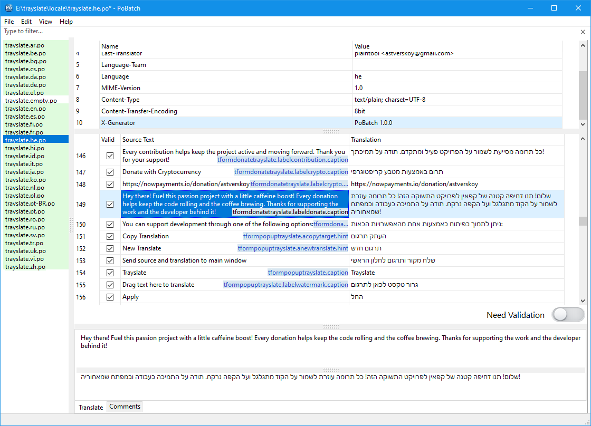

<p align="center">
  
</p>

<h1 align="center">PoBatch</h1>

PoBatch is an easy-to-use PO file editor for l10n workflows. It displays source strings and translations in a grid, allowing selection of columns or rows and bulk copy and paste operations. This makes it easy to quickly update translations within a PO file.

[](https://www.gnu.org/licenses/gpl-3.0)
[](https://www.lazarus-ide.org/)
[](#)
[](https://github.com/plaintool/pobatch/releases/latest)

> [!WARNING]
> **This project is still under active development.**
>
> While it is already functional and useful, some features may continue to evolve and occasional issues may still occur.
> As a general best practice, it is recommended to keep backup copies of your translation files.



---

## Installation

[](https://github.com/plaintool/pobatch/releases/latest)

### Windows

Several installer options are available on the releases page:

| Description | Files |
|-------------|-------|
| **User installer (MSI)** — installs the application **for the current user** | `pobatch‑x64.msi`<br>`pobatch‑x86.msi` |
| **System installer (MSI)** — installs the application **for all users on the system** | `pobatch‑x64‑allusers.msi`<br>`pobatch‑x86‑allusers.msi` |
| **Portable version** — saves its settings to `form_settings.json` if it is near the executable; otherwise, in the user directory | `pobatch‑x86‑x64‑portable.zip` |

Download the installer from the [releases page](https://github.com/plaintool/pobatch/releases), run it, and follow the on-screen instructions. After installation, you can launch PoBatch from the Start menu or from the desktop shortcut.

---

### Linux
### *Debian-like systems (Debian, Ubuntu, etc.)*

Download the appropriate `.deb` package for your system from the [releases page](https://github.com/plaintool/pobatch/releases), or use `wget` directly. An example of using `wget` is provided on the release page.

If you downloaded the package manually, you can also install it via:
```bash
sudo dpkg -i /path/to/pobatch.deb
```
If there are missing dependencies, fix them by running:
```bash
sudo apt-get install -f
```

### *RPM-based systems (Fedora, RHEL, CentOS, openSUSE, etc.)*

Download the appropriate `.rpm` package for your system, or use `wget` directly. An example of using `wget` is provided on the release page.

If you downloaded the package manually, you can also install it via:
```bash
sudo dnf install /path/to/pobatch.rpm
```
If there are missing dependencies, fix them by running:
```bash
sudo dnf install -y gtk2
```

---

## Console mode

Besides the graphical interface, PoBatch can run batch operations directly from the command line — useful for scripts, CI/CD pipelines, and headless automation. When a known command is present, the application performs the operation and exits without showing the main window.

### Usage

```text
pobatch <command> <target> [options]
```

Run `pobatch --help` to print the full list of commands, targets, and options at any time.

### Commands

| Command | Description |
|---------|-------------|
| `copy-source`   | Copy source text into empty translations |
| `clear-fuzzy`   | Clear translations of fuzzy entries |
| `clear-all`     | Clear all translations (headers are preserved) |
| `mark-valid`    | Remove the fuzzy flag from all entries |
| `sync-pot`      | Synchronize with the reference POT file |
| `translate`     | Translate empty entries via the configured service |
| `new-from-pot`  | Create new PO files from a POT for the given languages |
| `rename`        | Rename files by base name |

### Targets

One target is required for most commands.

| Target | Description |
|--------|-------------|
| `--file <path>`    | Process a single PO or POT file |
| `--dir <path>`     | Process all PO and POT files in a directory |
| `--files <p1;p2>`  | Semicolon-separated list of files |

### Options

| Option | Description |
|--------|-------------|
| `--pot <path>`     | Reference POT file (`sync-pot`, `new-from-pot`) |
| `--langs <c1,c2>`  | Target language codes (`new-from-pot`) |
| `--name <base>`    | New base name (`rename`) |
| `--config <path>`  | Translation config file (name or full path) |
| `--source <lang>`  | Source language code (default: `en`) |
| `--target <lang>`  | Target language code |
| `-h`, `--help`     | Show help and exit |

> [!NOTE]
> Without `--config`, PoBatch uses the translation profile that was last selected in the GUI. Pass `--config` to override it explicitly — for example `--config config/mymemory.ini`.

### Examples

```bash
# Copy source text into empty translations across a whole directory
pobatch copy-source --dir ./locale

# Remove the fuzzy flag from a single file
pobatch mark-valid --file ./locale/app.ru.po

# Synchronize every PO in a directory with its matching POT
pobatch sync-pot --dir ./locale

# Translate all empty entries into Russian using a specific profile
pobatch translate --dir ./locale --target ru --config config/mymemory.ini

# Create Russian and German PO files from a template
pobatch new-from-pot --pot ./locale/app.pot --langs "ru,de"

# Rename all files in a directory to a new base name
pobatch rename --dir ./locale --name myapp
```

POT files are skipped by translation and clearing commands, since they contain no translations. `rename` touches every file, including POT — this keeps the `<base>.pot` pairing valid for later `sync-pot` runs.

### Automation notes

- **Windows:** the application is linked as a GUI binary, so `cmd.exe` returns the prompt before the operation finishes. In scripts and CI, either redirect the output (`pobatch ... > log.txt 2>&1`) or use `start /wait "" pobatch.exe ...` to wait for completion.
- **Linux / macOS:** `--help` runs without an X server, but commands that load a document still need a graphical session. Use `xvfb-run -a pobatch ...` inside headless CI environments.
- **Exit code** is `0` on success and `1` on error, so the result can be checked directly in shell scripts.

---

## Donate 💖

If you like PoBatch and want to support its development, you can send a donation:

You can support PoBatch development through one of the following options:

💳&nbsp;[Donate with Bank Card or PayPal](https://app.lava.top/en/astverskoy?tabId=about&currency=EUR)  
&nbsp;₿&nbsp;&nbsp; [Donate with Cryptocurrency](https://nowpayments.io/donation/astverskoy)

Every contribution helps improve PoBatch and keep the project active. Thank you for your support! 🙏

## Licensing

PoBatch is licensed under the GPL v3 license. See the LICENSE file for details.

The PoBatch application uses third-party resources licensed as described in the [THIRD_PARTIES](THIRD_PARTIES) file.